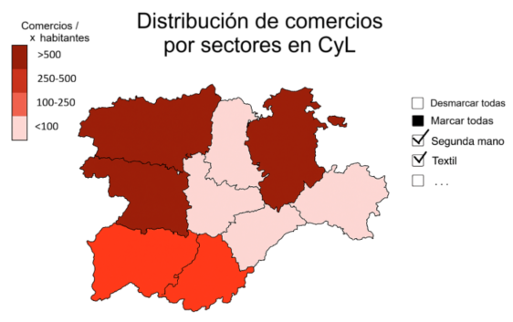
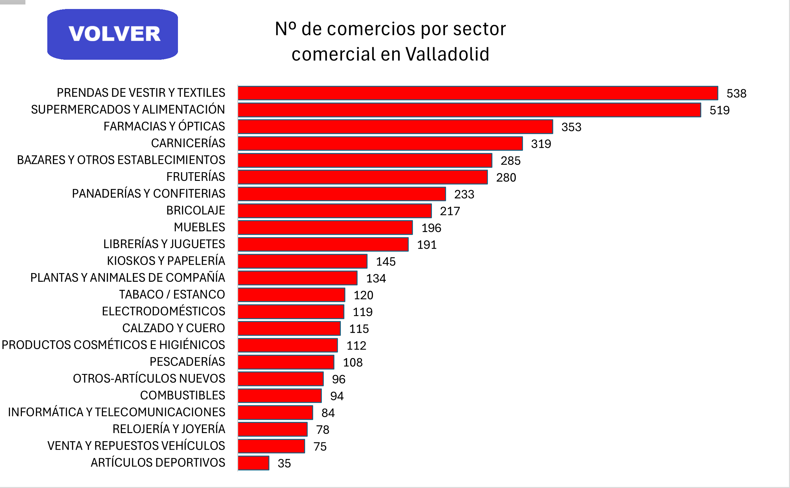

# Comercios por sectores y provincias en Castilla y León

## 📄Descripción del proyecto
Proyecto desarrollado para la asignatura Diseño y Evaluación de Sistemas Interactivos (DESI).
La idea es realizar una visualización interactiva con los datos sobre los comercios en Castilla y León 
clasificándolos por provincias y sector con la intención de ayudar a los comerciantes a tomar decisiones.
Para ello se usará la biblioteca de javascript D3.

## 📊 Descripción de la visualización
La visualización (a la que se puede acceder desde este [enlace](https://gitlab.inf.uva.es/dierequ/visualizacion_desi.git "Visulización"))
consta de dos representaciones:

La primera de ellas se trata de un mapa cloroplético en el que se representa la proporción de comercios en
relación con los habitantes de cada provincia de Castilla y León. Cuenta con un apartado de filtros para poder
elegir los datos de que sectores comerciales mostrar. Al pasar el ratón por encima de una provincia se muestra
el dato exacto de la provincia correspondiente y al pulsar en la provincia se muestra el segundo tipo de representación
con los datos de esa provincia.

.

La segunda representación es un gráfico de barras horizontales con los datos del número de establecimientos
de cada sector comercial de la provincia seleccionada. Cuenta también con un botón para volver al mapa cloroplético.

.

## 📂 Estructura
```
Visualizacion_DESI/
│
├── index.html              # Archivo html con la estructura principal de la visualización
├── img                     #Imágenes utlizadas para el README
│   ├── graficoBarras.png
│   ├── mapa.png          
├── js/
│   ├── contolEventos.js    # Inicialización y control de los eventos de cotrol y ratón
│   ├── dibujar.js          # Dibujo y actualización de gráficos D3
│   └── data_manager.js     # Procesamiento, normalizado y administración de datos (ya veremos)
├── data/
│   └── habitantesProvincias.csv       # Datos de los habitantes de cada provincia
│   └── numeroEstablecimientos.csv     # Datos de los comercios por sectores y provincias
└── provincias-CastillaYLeon.json      # GeoJson para dibujar el mapa de CyL
└── README.md               # Este documento con la descripción del proyecto
```

## 💻 Tecnologías utilizadas
* HTML5
* JavaScript (ES6)
* D3.js v7
* GitLab (Este [repositorio](https://gitlab.inf.uva.es/dierequ/visualizacion_desi.git "Repositorio del proyecto"))

## ⛲📈 Fuentes de datos
* Fuente 1: Dataset con el que se ha trabajado para extraer los datos: 
Dirección General de Comercio y Consumo - Consejería de Industria, Comercio y Empleo
* Fuente 2: Archivo GeoJson para dibujar el mapa de CyL: proporcionado por los
profesores de la asignatura.
## 👨‍💻👨‍💻 Autores
Diego Requejo Alonso (dierequ) - diego.requejo23@estudiantes.uva.es

Hugo Villagrá de Bustos (hugvill) - hugo.villagra23@estudiantes.uva.es 